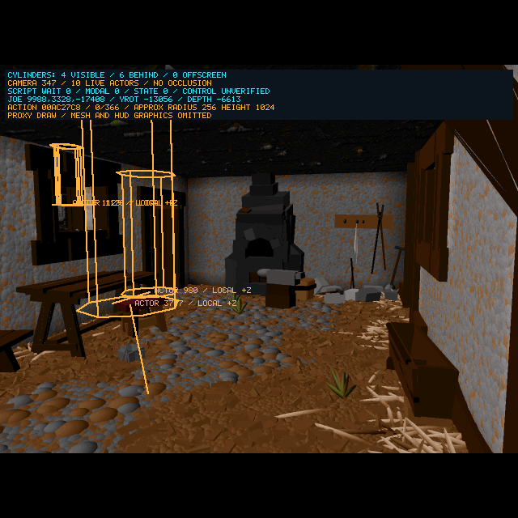

# Blacksmith Sword Activation — 2026-10-20

<!-- docs-tree:parent -->
[Project README](../../../README.md) · [Parent: Project Journal](../journal.md)
<!-- /docs-tree:parent -->

Task: [Step 09 Task 09](../../implementations/playable-sdl-runtime/steps/step-09/tasks/task-09-recover-scene-population-and-interaction.md).

## Result

Original sword actor **3717**, `nschwrt1`, now activates from preloaded scene **1909** at **(-972, 3884, -10208)** and projects as an orange cylinder beside the workbench in **camera 347**. Debug and ASan pass the original-resource integration check, restore the courtyard view without moving Joe, then complete a populated **175 → 166 → 175** route and five seconds of released-input observation.



This image uses a diagnostic camera selection through the game's normal view/visibility sweep, followed by the existing SDL presenter. Joe remains at his actual courtyard coordinates, outside this view. Neither Joe nor the sword is repositioned; the sword is loaded and placed by its original resources. This is asset activation/presentation evidence, not a manual walk into the workshop, sword mesh rendering or pickup acceptance.

## Evidence And Repairs

The [location audit](blacksmith-sword-location-2026-10-20.md) identifies the user's matching screenshots and F12 packet. A new read-only release census establishes that `mar:StartUp` already executes preload opcode **0x4d** for scene 1909 (token `0x4775`). Its scene record and child track exist, scene table flags are `0x06`, actor flags are `0x02`, and actor 3717 has no live instance. The missing sword is therefore downstream of original script preload, independently of wandering NPC population.

Four recovered contracts are required:

1. **Preload placement.** Original `0x44f8a7..0x44f8d1` copies a position event into the actor-ID placement cache at `0x669708 + id*6`, then into an existing actor if present. The C copied the event onto itself and passed a lost register to the second copy. The repaired cache contains the sword's exact original position. Visibility now queries that vector.
2. **Visibility directory.** The loose `Files/ECSTATIC` starts with FAN data. Its existing fallback scanner clears all 1,200 visibility offsets and never rebuilds them. The original root **`OFFSETS`** file is the matching 56,240-byte big-endian directory consumed by original `0x447d94`'s table layout. Its last 1,200 words begin at byte 51,440. All **1,117** present entries point to valid `VisM` payloads in the installed archive; camera 347's offset is `0x1f220cc`. The recovered-action route reads and validates this final visibility table only, preserving other resource lookup boundaries. Missing or mismatched data leaves it unchanged. The existing original-shaped visibility reader/marker then sets the descriptor bits; the sword's descriptor changes from `0x0000` to `0x4000`.
3. **Visibility activation.** Original `0x44d4b4` uses cached placement for an absent actor or a preloaded scene track (`0xc000`), retaining the requested ID into `0x44d634`. The C omitted the loaded/preloaded branch and called the loader without its ID. The recovered `0x44d634` retains actor ID, recursive attachment owner, saved current actor, pose/action context, script callbacks and scene/action track pointers. It uses the existing scoped archive-identity loader, so the sword is read from its actual resource at `0x7a3924`. The zero-time child track supplies original position/rotation; the temporary action/scene owner clears as in the original instructions. Joe stays current.
4. **Newly active object updates.** Restored visibility also activates original courtyard objects. Actor 3019 first exposes a garbage idle-action pointer: original `0x429bf8` leaves ECX zero when a representation's selected idle slot is absent; the C overwrote that zero with `extraout_ECX_44`. Retaining zero crosses that crash. A subsequent landing path requests missing action 56 because `0x449680` passes vertical velocity to the action loader. Original `0x44984b` passes the selected landing action retained in EBX; the C now passes `iVar3`. This crosses the requester and retains the queued actor/action inputs.

No object-name whitelist, synthetic object, direct scene-1909 start, camera-number-as-script-ID activation or coordinate edit is added. The existing F5 flags suffice; no launch change is needed. Every reconstructed repair is mirrored in `GenerateRecon.js`.

## Diagnostics And Reproduction

F12 now dumps loaded script scenes referring to the current camera, including scene IDs 1200–2499, and their children even when Joe has no scene owner. Each child records cached placement, pending scene/action track and attachment owner alongside loaded pointer and global-list membership. Camera IDs and script-resource IDs remain separate.

The motion probe's new **`--inspect-object-scene 1909`** requires the scene to be preloaded. It selects that scene's original camera through `FUN_0044be20`, checks Joe ownership/coordinates, records active scene children and on-screen cylinder eligibility, presents through the normal SDL host and restores the original camera. Its JSON explicitly labels the camera selection diagnostic. It does not start the selected script scene or set an actor position.

```sh
python3 scripts/probe-e2-player-motion.py \
  build/Debug/clang21-i386-sdl/e2recomp \
  --intro-skip-action 1 --pedestal-guards --background-spawns \
  --population-frames 180 --require-background-population \
  --inspect-object-scene 1909 --camera-round-trip --burst-frames \
  --observe-seconds 5 --timeout 180 --output /tmp/e2-sword-route-debug
```

The equivalent ASan command uses `build/Debug/clang21-i386-sdl-asan/e2recomp`. Final prefixes are `/tmp/e2-sword-route-debug` and `/tmp/e2-sword-route-asan`; both object-view JSON files assert actor 3717 active, projected on screen and at the original cached placement. Separate 180-frame integration continuations pass under `/tmp/e2-sword-final-{debug,asan}`. The saved image is from the Debug integration run.

## Validation And Limits

- `check-e2-object-activation.py EXE [--asan]`: **8,192** original-x86 activation cases, including recursive attachment loading, absent actors, callbacks, scene/action tracks, pose preservation and surrounding memory; **1,024** visibility-selection cases; **1,024** placement/cache/live-copy cases. Allocation/loading, pose evaluation, script execution and action advancement are intercepted. These are contract comparisons, not full gameplay emulation.
- `check-e2-player-idle-caller.py EXE [--asan]`: existing **1,440** queued-idle cases plus **4,608** absent/present random-idle cases and **780** landing-action loader/queue cases.
- `check-e2-visibility-index.py ARCHIVE OFFSETS [--asan]`: all **1,117** installed original visibility offsets, plus five missing/truncated/mismatched data cases; failed validation does not partially replace the table and all temporary stream allocations are released.
- Normal/ASan checks above pass. Original population and script-flow regressions pass under ASan. All four SDL/X11 Debug/ASan builds, generator syntax and independent C/header/globals/names generation parity pass without unrelated generated drift.
- Populated Debug/ASan object integration and courtyard round trips pass. The baseline runtime wrapper and all eight arrow rows pass (`/tmp/e2-sword-regression.log`, `/tmp/e2-sword-arrows.log`).
- Default SDL requester presentation, OK dismissal, resumed update and Escape menu entry pass in Debug/ASan (`/tmp/e2-sword-modal-{debug,asan}-check.log`).

The temporary intermediate failures after enabling visibility are fixed as described above; their logs are `/tmp/e2-sword-visibility-index-debug.log`, `/tmp/e2-sword-index-crash-debug.log` and `/tmp/e2-sword-static-idle-debug.log`.

Ordinary F5 re-entry into the user's workshop location remains a manual check. Sword pickup, acquired/equipped state, blacksmith script activation, attack/door-destruction animations, wider object categories and full experimental ASan acceptance remain open. The next implementation target is the sword's original proximity/input and pickup contract after confirming its presence on that route. Existing staged changes remain staged; this continuation stays unstaged and no commits are made.
