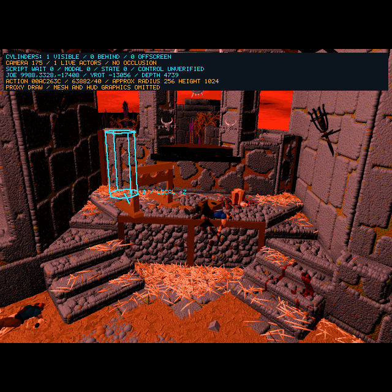

# 2026-10-14 — Restore Courtyard Floor Decoding

<!-- docs-tree:parent -->
[Project README](../../../README.md) · [Parent: Project Journal](../journal.md)
<!-- /docs-tree:parent -->

Area: hosted stream byte reads and FAN floor descriptors.

Symptom: the user confirms the palette repair and a visible cylinder during freeing, but Joe enters forest camera 221 immediately after the pedestal intro. That is fallback resource 7, not the expected courtyard gameplay.

## Evidence And Repair

The terminal position event executes and writes the action's encoded `9988,3328,-17408`. At the subsequent camera lookup, the completed action and scene owner have been cleared normally; the owner has no end callback (`+0x98 = -1`). This places the failure in the world data/query route rather than establishing a missing teleport or completion callback.

A GDB dump finds **zero** camera-175 floor descriptors before this fix. The main FAN has version 55 and 49,650 floor entries. Its grid words are decoded in the correct order and byte order. The descriptor payload loses alignment: entry 27,625's encoded floor/shape bytes `3b 11` become `ff 3f`, with ceiling `ff` and a wrong view. Corrected unsigned ceiling selection rejects that corrupted descriptor, leading to resource 7.

`FUN_00447638`'s inline byte reads call `FUN_0045f38a` when they encounter `0x0d` or `0x1a`, even in binary mode; the fallback must consume the actual byte. The reconstructed `0x45f38a` rejects pointers at or above `0x70000000` before checking `E2R_STREAM_MAGIC`. The actual hosted stream is at `0xf6636008`. It returns -1 **without advancing the cursor**, shifting later descriptor fields. The word reader already accepts the hosted stream, so this failure is specific to the inline byte fallback. The old end-of-section cursor alignment cannot repair entries already decoded incorrectly.

The repair checks readability and the hosted header before applying the low-address guard to legacy streams. It preserves raw binary CR/0x1a bytes and one-byte cursor advancement. No actor coordinates, camera IDs or floor heights are substituted. The exact C repair is mirrored by a small anchored generator patch.

Corrected reads remain enabled with `E2R_ACTION_INDEX_PROBE`, already present in **Ecstatica Recompiled**. Making them global exposes the default route's unrecovered placement/spawning and fails its requester baseline. Its old rejection remains a documented temporary limitation; it is not correct hosted-stream behavior. This is consistent with the existing gated expanded script pool and unsigned floor selection.

After repair, the decoder produces 77 camera-175 descriptors. Entry 27,625 becomes `3b 11 00 00 23 37 08 3b ef 02 ef 02`, consistent with its encoded fields. Other entries in Joe's cell chain supply the courtyard camera; the actual post-release query selects 175 without the old handoff guard substituting a scene.

## Continuous Debug Result



The 35-second packet from `/tmp/e2-floor-stream-live` shows camera 175, Joe `9988,3328,-17408`, one visible cylinder, depth 4739, script wait 0/modal 0, actor state 4 and facing -13056. The indexed background remains `321e33d6`, palette `cd25bfd5`; SDL present/window hashes are `a463d3c7` / `ced853c7`. Release completes and the forest/menu fallback is absent in this run. Up latches, but coordinates remain fixed; the action field is `0xac263c`, duration 40, progress 63882. **This is a courtyard handoff proof, not controllable gameplay.**

The capture uses continuous SDL presentation, the three F5 flags, zero logo delay and queued key-downs; no paused redraw, coordinate edit or forced camera. The supplied user screenshot confirms the prior forest/palette state, not this new fix. Manual editor acceptance remains open. Phase-aware logo taps, the shortened horseback skip and key releases still require separate probes.

```sh
cmake --build --preset linux-clang32-sdl-debug
env -u DISPLAY SDL_VIDEODRIVER=dummy E2R_STARTUP_LOGO_DELAY_MS=0 \
  E2R_ACTION_INDEX_PROBE=1 E2R_ACTOR_CYLINDERS=1 E2R_PROXY_MESH_BYPASS=1 \
  E2R_DEFER_BACKGROUND_SPAWNS=1 \
  E2R_VISIBILITY_DUMP_PREFIX=/tmp/e2-courtyard-repro \
  E2R_VISIBILITY_DUMP_AFTER_MS=35000 \
  timeout 50 build/Debug/clang21-i386-sdl/e2recomp \
  --inject-key-sequence-surfaces /tmp/e2-courtyard-repro-surfaces \
  space,space,up 3 10000 44
```

## Validation And Remaining Limits

`scripts/check-e2-floor-decoder.py` compares the actual reconstructed descriptor loop with original `0x4476e6..0x4479dd` instructions. It passes **4,096 FAN-55 entries** and **256 high-address binary-byte cases**, normally and under ASan. All byte values occur, including embedded CR/0x1a; the comparison checks descriptor bytes, cursor and remaining length. Binary byte/word services are intercepted; this is not a proof of the whole CRT text-mode or FAN parser. It exercises the existing action-index gate.

```sh
python3 scripts/check-e2-floor-decoder.py /home/rgrabowski/Games/Ecstatica2/E2WIN95.EXE
python3 scripts/check-e2-floor-decoder.py /home/rgrabowski/Games/Ecstatica2/E2WIN95.EXE --asan
```

The experimental ASan route still faults in `FUN_00448744 → FUN_00448a48`, called with a lost random-position vector from `FUN_0044dca4 → FUN_0044e354`. A separate Debug probe instead faults later in `FUN_0044db80`, which also lacks its actor-range input. This is the **NPC spawn/population path**, not a decorative effect that can be omitted: it loads and places live actors, changes actor flags and participates in the population limit. These existing input defects make repeated runtime routes unstable; the successful continuous capture does not establish 60 seconds of playability or ASan handoff coverage.

Original `0x44dd24/0x44dd32/0x44dd3f` pass the same contiguous local world vector to floor, visibility and descriptor queries. The C uses lost register values and separate scalar locals. Original `0x44db87` retains EAX as the first actor ID and EDX as range length across RNG; C has an uninitialized first ID. Recover these contracts and required activation/placement dependencies in [Task 04](../../implementations/playable-sdl-runtime/steps/step-09/tasks/task-04-recover-npc-spawn-query-inputs.md). Do not skip all of `FUN_0044e354`, force a population count or disable simulation queries.

Movement remains [Task 02](../../implementations/playable-sdl-runtime/steps/step-09/tasks/task-02-recover-post-intro-placement-and-motion-queries.md). Validate keyboard selection, selected action, retained actor/root-motion inputs and floor vectors before claiming displacement/turning. The previously identified selected-slot/strict completion and actor transform candidates remain unproven fixes; they were not changed here.

## NPC Input Recovery And Current F5 Prototype

The repeat of the floor-only repair faults in `0x44db80` before release. Its sibling `0x44dca4` is actual NPC population/placement logic. Recovering the query vector, terrain-to-actor ranges, selected load ID, actor ownership and nine floor samples eliminates these lost-input contracts. The two reconstructed functions are rewritten around retained inputs/arrays; their reduced generated diff is intentional and bounded to these routines. `scripts/check-e2-npc-spawn.py` compares 448 range cases and 1,060 terrain/query/placement cases against original instructions, normally and under ASan. File/query/activation services are intercepted; this does not validate actual asset loading or AI.

An intermediate spawn-on runtime reaches an invalid requester during actor loading. Full automatic NPC activation remains open. For the user's Joe-first primitive milestone, F5 now adds **`E2R_DEFER_BACKGROUND_SPAWNS=1`**. It explicitly defers only terrain-driven background creation at `0x44dca4`, keeps existing actors/scripts and player physics/view queries, and states **BACKGROUND SPAWNS OMITTED** in the diagnostic panel. This is a prototype simulation limit, not a visual omission or full NPC recovery. The default is off outside F5. Task 04 retains full spawn-on acceptance after basic Joe control.


The final four-flag Debug packet at 35 seconds is camera 175, Joe `9988,3328,-17408`, wait 0/modal 0, one visible cylinder, and `background_spawns_deferred=1`. Indexed/palette hashes remain `321e33d6` / `cd25bfd5`; SDL/window `c018b14b` / `4c3eb14b`. Prefix `/tmp/e2-courtyard-prototype`. Up latches without displacement. This supersedes the earlier successful but unstable three-flag capture, and does not establish user/editor acceptance or locomotion.

ASan with deferral now passes the former NPC query entry and reaches release, but faults in `FUN_0042b004` following malformed event link `0x77643a` after event `0x776434` (type 0x17). Debug follows `0x776442`. Prefix `/tmp/e2-courtyard-prototype-asan`. Recover the link writer/root-pose inputs before calling this sanitizer-safe or playable.

All four Debug builds, generator syntax/in-place/scratch parity, decoder/spawn/cylinder fixtures and final default wrapper plus both SDL requester checks pass. Cylinder tests include read-only deferred-spawn status. Default logs `/tmp/e2-prototype-final-regression.log`, `/tmp/e2-prototype-final-modal.log` and `/tmp/e2-prototype-final-modal-asan.log`. The arrow matrix was not repeated for this continuation; its earlier result remains input-latch coverage. No 60-second control/traversal acceptance is claimed.
