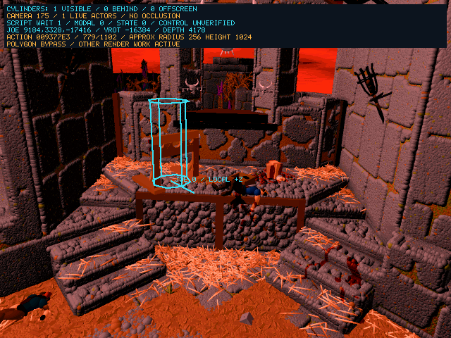

# 2026-10-14 — Diagnostic Cylinders And Polygon Boundary

<!-- docs-tree:parent -->
[Project README](../../../README.md) · [Parent: Project Journal](../journal.md)
<!-- /docs-tree:parent -->

Area: read-only actor snapshots, SDL presentation and an opt-in reconstructed raster boundary.

Symptom: input latches pass, but the default runtime has no loaded actions and Joe projects behind the pedestal camera. Original mesh/lighting/copy failures prevent inspection of the recovered action route. The user prioritizes cylinder-based movement and scene testing over original visual fidelity.

## Change

`E2R_ACTOR_CYLINDERS=1` enables projected octagonal wireframe cylinders on the SDL RGB presentation surface. The native snapshot projects both rings using the recovered private camera math, with diagnostic radius 256 and height 1024. Cyan is actor 0; amber means another table-confirmed live actor. The local +Z line uses the actor's matrix at +6; it is an orientation axis, not a claim about the original model's forward convention. Original `0x4210b8..0x421101` supplies the actor matrix from Euler words +90/+92/+94; the panel reports the Y rotation at +92.

The panel and visibility sidecar record camera slot, actual position/depth, action pointer/progress, script-wait and requester state. Control remains explicitly **unverified**. Segments reject invalid depth and clip to the viewport before rasterization; an offscreen centre does not hide an intersecting cylinder. Every indexed-to-RGB conversion restores the presentation before drawing, preventing host-cylinder trails. Approximate dimensions and missing background occlusion are explicit limitations.

`E2R_PROXY_MESH_BYPASS=1` gates only `FUN_00424e44`, mirrored in `GenerateRecon.js`. Original `0x424e44..0x424e95` selects polygon/reference/mode and calls raster dispatcher `0x433d30`. The bypass does not skip `FUN_004211c8`, actions, logical poses, actor/root updates, camera queries, mesh preparation, other rendering leaves or dirty/HUD copies. It is a partial raster bypass, not a completed replacement renderer.

The fixture compiler also exposed a missing window-ID argument in the SDL key-up diagnostic format string; the argument is now supplied. Input behavior is unchanged.

## Real Runtime Result



This is a stopped-runtime capture, not a gameplay success. Two gated Debug runs stop in `FUN_0042b880` event `0x3f → FUN_0043ab74`, whose `in_EAX` is uninitialized. Joe is at `9184,3328,-17416`, depth **4178**, projected ground point `242,256`; the cylinder is visible in camera 175. Action `0x9377e3` remains at **779/1102**, script wait is **1**, and only one table-confirmed actor is live. No actor position or action progress was injected to obtain this image. GDB calls presentation/capture after the stop.

The selected game page remains static hash `321e33d6`; cylinder-enabled SDL presentation/window hashes are `5e3e1999` / `8cb15999`. The second trace first hits `FUN_00424e44`, confirming the bypass boundary is reached. Logs: `/tmp/e2-cylinders-gated.log`, `/tmp/e2-cylinders-gated-packet.log`; capture sidecar: `/tmp/e2-cylinders-gated-packet-state.txt`.

Original `0x42c041..0x42c043` passes ESI in EAX to `0x43ab74`; `0x43ab79` retains the node in EDX. Caller node selection, helper unlinking and cleanup context are the next independent repair, scoped in [Step 09 Task 01](../../implementations/playable-sdl-runtime/steps/step-09/tasks/task-01-recover-action-event-node-removal.md). The DirectDraw Lock 0/0 provider remains a known full-render defect. These traces do not prove it unnecessary on later proxy/HUD paths; they reach an earlier action failure with the current bypass.

## Verification

All four Debug builds pass: SDL, SDL ASan, X11 and X11 ASan. Generator syntax passes; all four generated outputs match scratch regeneration at `/tmp/e2-cylinders-parity-rdgs4pyu`. The generated C change is confined to the six-line raster gate.

`scripts/check-e2-actor-cylinders.py` extracts the actual snapshot and recovered camera functions and compiles them with the real SDL backend. Synthetic actors verify depth scaling, position/rotation response, near-plane and viewport rejection, centre-outside visibility, invalid table ownership, a bounded self-link, unchanged mapped game state/indexed pixels and erasure on the next RGB conversion. Normal and ASan fixtures pass. Fixture images are deliberately separate from the real capture above: `/tmp/e2-cylinder-fixture-sdl-present.ppm` and `/tmp/e2-cylinder-fixture-asan-sdl-present.ppm`.

Polygon comparisons pass 576 original-x86 routing cases and twelve temporary-record cases normally and with ASan; the added bypass check proves no raster dispatch and unchanged polygon data. The default wrapper, all eight arrow rows and SDL Debug/ASan requester capture/OK/Escape checks pass. SDL requester checks enable cylinders but keep action indexing and polygon bypass disabled. Logs use `/tmp/e2-cylinders-{regression,matrix,requester-debug,requester-asan}` prefixes.

The separate real gated SDL ASan probe exits **5** after 35 seconds in camera 1073 (`/tmp/e2-cylinders-gated-asan.log`), without an ASan report. It does not reach the pedestal event or prove that path sanitizer-clean. Its early skip is not a robust phase-aware gameplay probe; G7 still owns that improvement.

Run from the repository root:

```sh
python3 scripts/check-e2-actor-cylinders.py
python3 scripts/check-e2-actor-cylinders.py --asan --output /tmp/e2-cylinder-fixture-asan
python3 scripts/check-e2-polygon-inputs.py /path/to/E2WIN95.EXE
python3 scripts/check-e2-polygon-inputs.py /path/to/E2WIN95.EXE --asan
env -u DISPLAY E2R_SKIP_BUILD=1 E2R_REGRESSION_TMP=/tmp/e2-cylinders-regression scripts/run-e2-runtime-regressions.sh
env -u DISPLAY E2R_SKIP_BUILD=1 E2R_CONTROL_MATRIX_TMP=/tmp/e2-cylinders-matrix scripts/run-e2-control-matrix.sh
E2R_ACTOR_CYLINDERS=1 E2R_PROXY_MESH_BYPASS=0 python3 scripts/check-e2-postintro-requester.py build/Debug/clang21-i386-sdl/e2recomp --output /tmp/e2-cylinders-requester-debug
E2R_ACTOR_CYLINDERS=1 E2R_PROXY_MESH_BYPASS=0 python3 scripts/check-e2-postintro-requester.py build/Debug/clang21-i386-sdl-asan/e2recomp --output /tmp/e2-cylinders-requester-asan
```

The gated Debug repro uses this GDB command file:

```gdb
set pagination off
set confirm off
tbreak FUN_00424e44
run
continue
bt 12
frame 0
info args
p DAT_0047a76c
call e2r_present_current_frame((HWND)_DAT_00ac4dac,1)
call e2r_write_visibility_packet((HWND)_DAT_00ac4dac,"/tmp/e2-cylinders-gated-packet")
quit
```

```sh
env -u DISPLAY SDL_VIDEODRIVER=dummy E2R_STARTUP_LOGO_DELAY_MS=0 E2R_ACTION_INDEX_PROBE=1 E2R_ACTOR_CYLINDERS=1 E2R_PROXY_MESH_BYPASS=1 timeout 55 gdb -q -batch -x /tmp/e2-cylinders-gated-packet.gdb --args build/Debug/clang21-i386-sdl/e2recomp --auto-scene175-visibility /tmp/e2-cylinders-gated-followup 35 7000
```

The zero-logo-delay route is a crash diagnostic, not validation of the reference video's separate logo/horseback skip taps or natural intro timings. Manual desktop SDL and actual locomotion/traversal remain unverified.

Regression risk: the bypass omits raster-side effects, and other geometry/copy paths remain active. Logical/root-motion pose evaluation cannot be disabled wholesale. Cylinders are read-only diagnostic stand-ins; size and overlap are not collision authority. Keep both new flags opt-in.
