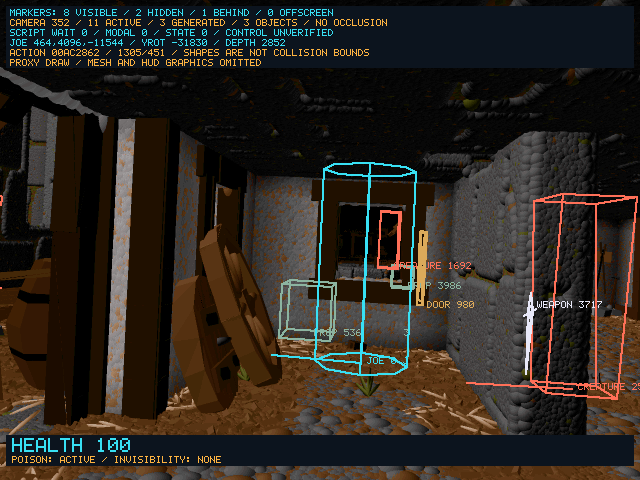

# Diagnostic health and potion status — 2026-10-24

<!-- docs-tree:parent -->
[Project README](../../../README.md) · [Parent: Project Journal](../journal.md)
<!-- /docs-tree:parent -->

Task: [Step 09 population and interaction](../../implementations/playable-sdl-runtime/steps/step-09/tasks/task-09-recover-scene-population-and-interaction.md).

The user confirms the latest bottle/sword check but cannot evaluate health or
potion effects because the diagnostic route omits the original HUD. Wider item
coverage, extended stability work and original rendering are explicitly deferred.
The immediate work is to make health and potion effects observable, then verify
their original behavior.

## Latest human run

Session **20261024_152305_822** is finalized, with complete replay/inspection and
clean exit **0**. Its pinned Debug SHA-256 is
`4544fc096271fb51f1430c5e295776dca58798256b6f94c5661fe11ab88dbd3c`.
This review materializes inspection deltas; it does not rerun exact replay.
The last inspection event is snapshot **1301**, checkpoint **783**, sequence
**3,134,804,229**, with an ordinary end event.

Bottle **537** attaches at snapshot **454**, runs `glofade` (**688**) and `potvan`
(**1574**), then loses both attachment and representation at **470**. Sword
**3717** attaches at **855**, with subsequent sword attack actions recorded.
This supplies human confirmation of the previous bottle-removal fix.

Joe's recorded health falls **100 → 95 → 90 → 85 → 80 → 75 → 70** before
drinking. It remains **70** across that pickup. Later it falls to **65**, then
returns to **70**. These observations establish damage and changing health,
without attributing the later increase to this potion or proving a healing
branch. Random potion dispatch remains relevant to acceptance.

## Read-only display

The SDL diagnostic view now shows a bottom panel with doubled-size **HEALTH**
text and **POISON / INVISIBILITY** indicators. It remains visible when Joe is
offscreen and disappears with the rest of the overlay during modal menus.
No original HUD graphics or reconstructed game behavior are changed.

Health comes from Joe's existing signed **+0xec** observation. Potion indicators
observe his current action and original timer list at **+0x17c**, bounded to the
original **100 × 10-byte** pool at **0x9373dc**:

- Poison is pending for queued **409**, active during **409** or **5**, or while
  **5**/`poisondie` is scheduled.
- Invisibility is pending for queued **383**, active during **383** or while
  **387**/`invisfade` is scheduled, and fading during **387**.
- **HEALING** appears during **391**/`gethealth`; the health number remains the
  actual recorded value, without assuming an amount or maximum.

These are action/timer diagnostics. They do not establish original mesh
appearance, invisibility's gameplay effects, cure correctness or future poison
death. Unknown outcomes are not inferred from a bottle's appearance or name.
Visibility packets include `player_status` with health, poison, invisibility and
healing. Status codes are **0 none, 1 pending, 2 active, 3 fading**.

## Verification and next work

The existing marker fixture passes normally and under ASan, checking actual
snapshot/drawing functions, unchanged game and timer memory, timer ownership,
bounded cyclic/invalid links, doubled text, offscreen Joe and modal suppression.
All four SDL/X11 Debug/ASan configurations build. Fresh input-only SDL routes
drink the workshop potion and observe **450** updates: Debug selects **189→183**,
displays health **100**, poison **ACTIVE**, and removes the bottle; ASan selects
**189→1803**, displays health **100** with no poison/invisibility indicator, and
also removes the bottle. No sanitizer report occurs. These routes disable
recording and do not assign health, RNG, actor/action, camera or timer state.

Final SDL SHA-256:

- Debug: `a64748d4d8953a664ffaa6804ea6a38c745971547b53771d8fc08b57d3b2e935`.
- ASan: `2b78573f4b3fc9f3ea914746447c6500ff22a94d2a5ae9efe7e761dab26050fe`.

Evidence/probe copies: `.tmp/status-review-20261024/`; temporary artifacts use
`/tmp/e2-status-{human,marker-fixture,live,build}*`. This change touches only host
diagnostics, their fixture and documentation; generated reconstruction is unchanged.
Next is human healing from damage and potion lifetime/cure observation with the
new display. Wider pickups, prolonged stability and rendering remain deferred
at the user's request. No commit or staging operation is performed.
