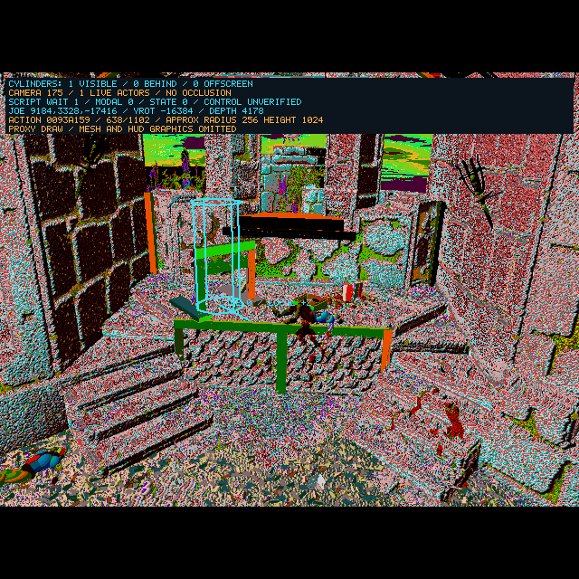
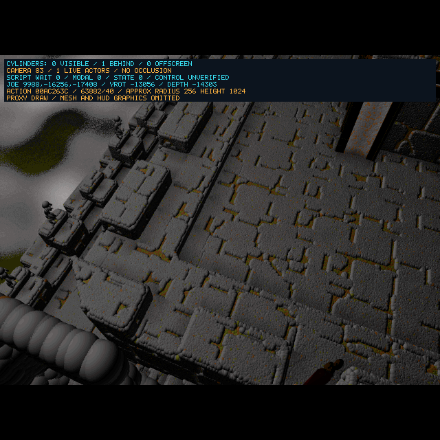

# 2026-10-14 — Align F5 With The Diagnostic Route

<!-- docs-tree:parent -->
[Project README](../../../README.md) · [Parent: Project Journal](../journal.md)
<!-- /docs-tree:parent -->

Area: VS Code launch, action-event ownership and script inputs.

Problem: the user's **Ecstatica Recompiled** F5 screenshots showed the old cue panel, Joe behind camera 175, the `dav:heropick` action-384 error and camera 87 after OK. The earlier cylinder screenshot came from an opt-in, debugger-stopped run. It did not represent the editor launch or successful gameplay.

Change: `.vscode/launch.json` now supplies `E2R_ACTOR_CYLINDERS=1`, `E2R_ACTION_INDEX_PROBE=1` and `E2R_PROXY_MESH_BYPASS=1`. CMake still chooses the executable/working directory; use the SDL i386 Debug preset and restart the debug session. Bare terminal launches retain the earlier baseline. The matching terminal command is:

```sh
cmake --build --preset linux-clang32-sdl-debug
E2R_ACTOR_CYLINDERS=1 E2R_ACTION_INDEX_PROBE=1 E2R_PROXY_MESH_BYPASS=1 \
  ./build/Debug/clang21-i386-sdl/e2recomp --run-recon
```

## Recovered Contracts

| Original evidence | Repair |
| --- | --- |
| `0x42c041` passes selected ESI node in EAX to `0x43ab74` | Event `0x3f` receives its selected node; owner tables, active/sibling chains, recursive children, vertices and dependent polygons retain original unlink/deletion behavior in `0x43a8f8/0x43a9a8`. |
| `0x42b00c/0x42b00e` retain slot/actor across all events | `FUN_0042b004` receives both explicitly and restores actor context across nested calls. |
| `0x42b44e..0x42b458` pass event/factor/actor/action independently | `FUN_0042c790` uses the event and retained actor instead of a global that nested events can clear. |
| `0x4469c4` bounds names at base + `0x5dc0`; `0x446a10` clears a new name's code slot | Recover the 24,000-byte script-name capacity, mutable-pool cache invalidation and new-slot initialization. Expanded capacity remains behind the action-index flag: making this global reached unrecovered graphics/scripts and broke baseline tests. The 6,000-byte default is a documented temporary limitation. |
| `0x42c517` selects callback code; `0x44f2fc/0x44f320` pass code/actor/node; nested `0x44f64d` selects child code | Keep selected script records and node ownership across nested interpretation. Reusing parent code caused recursion; stale scene-end code skipped intended logic. |
| `0x44e810` receives a cursor address and selected node; `0x44e74c/0x44e7a4` mutate that cursor | Recover explicit conditional/skip inputs and recursive cursor retention. Signed string-token high bits are preserved. |

The proxy flag also omits original 2D graphic registration/drawing at `FUN_004555b0` and the visual preparation of script graphic operations `0x27/0x29/0x2a`. Their original padded, signed operand spans remain intact. This avoids missing graphics-name/copy inputs and a cursor stall inside a title-cleanup script. Mesh transforms, action events, camera selection, control flags and required world queries remain active. HUD images are omitted in this diagnostic mode; the real `0x75` instruction still executes. This does not repair the original graphics provider.

## Continuous Runtime Evidence

The images below are from normal presentation with no GDB pause, coordinate edits, readiness writes or manual redraw. They use the same three flags as F5, plus **diagnostic zero logo delay** and queued key input. They do not verify the editor's selected preset, physical key-up handling, the user's three logo taps or natural startup timings.



**Later correction:** the user confirmed that the colors in this historical capture were a regression. The [palette/release continuation](palette-and-release-handoff-2026-10-14.md) restores the fade inputs and supersedes the camera-83 result with an unresolved no-floor fallback/menu. The images below remain before-fix evidence.

At the 12-second packet: camera 175, one live/visible Joe, `9184,3328,-17416`, depth 4178, action `0x93a159`, progress `638/1102`, script wait 1, modal 0. The palette is corrupted; the initial interpretation as changing intro lighting was incorrect and is superseded by the linked correction. Indexed hash `321e33d6`. Packet/log prefix: `/tmp/e2-f5-pedestal-live`.



The longer run queues Space at 3 seconds, a separate Space roughly 10 seconds later, and Up another 10 seconds later. It reaches script opcode `0x75`, wait 0 and modal 0, then continues until its 44-second bounded exit. At the 35-second packet: camera 83, Joe `9988,-16256,-17408`, depth `-14303`, action `0xac263c`, duration 40 and raw progress 63882. Indexed hash `648e9d94`, SDL hash `84962869`, window hash `31176869`. Up latches, but Joe's coordinates stay fixed. **Gameplay, movement and traversal have not passed.** Packet/log prefix: `/tmp/e2-f5-continuous`.

A hardware watchpoint isolates the first bad-height write: `FUN_00449680` changes Joe's Y from 3328 to -16256 through `FUN_004495e0 → FUN_00427584`, after wait becomes zero. The queried grid cell is 27625, descriptor bytes `ff 3f 00 80 3f ff ff ff 53 00 1d 00`, scale 7; height byte 255 produces -16256. Do not clamp that result or substitute home coordinates. Determine why this position/descriptor is selected and recover the actual placement/control handoff. Gated ASan instead faults in `FUN_00448744` from the motion-query path; it does not cover the successful Debug handoff.

To reproduce the continuous Debug capture from the repository root:

```sh
env -u DISPLAY SDL_VIDEODRIVER=dummy E2R_STARTUP_LOGO_DELAY_MS=0 \
  E2R_ACTION_INDEX_PROBE=1 E2R_ACTOR_CYLINDERS=1 E2R_PROXY_MESH_BYPASS=1 \
  E2R_VISIBILITY_DUMP_PREFIX=/tmp/e2-f5-continuous \
  E2R_VISIBILITY_DUMP_AFTER_MS=35000 \
  timeout 50 build/Debug/clang21-i386-sdl/e2recomp \
  --inject-key-sequence-surfaces /tmp/e2-f5-continuous-surfaces \
  space,space,up 3 10000 44
```

This legacy key-sequence probe posts key-down messages and does not test releases. For the earlier pedestal packet, use a fresh prefix, delay 12000 and sequence `space 3 1000 18`. Actual F5 retains normal logo timing. Original-game three-logo taps and shortened horseback footage remain separate phase-aware acceptance targets.

## Validation

All repairs are mirrored in `GenerateRecon.js`. The following bounded original-executable comparisons pass normally and under ASan:

- Node removal: 768 list/table/recursive cleanup cases, plus null/error routing.
- Action reset: 96 key-order/slot-reset/actor cases, with nested global context deliberately clobbered.
- Interpolation: 576 actor/node field cases; branches calling unrecovered transform helpers are excluded.
- Script names: 256 appends beyond byte 6000, duplicate lookup, cache refresh and code-slot initialization.
- Script flow: 176 cursor cases, 64 wrapper input cases, 32 nested-record ownership cases and 243 diagnostic graphics operand spans. The interpreter entry is intercepted; this is not complete script-evaluation coverage.

Four Debug builds (SDL/X11, normal/ASan), generator syntax and scratch parity for all four generated artifacts, cylinder/polygon fixtures and default wrapper/SDL requester checks pass. Seven arrow-matrix rows passed initially; ASan Right received unrelated desktop Up/Alt before its synthetic keys. The same row rerun with `DISPLAY` unset passes its Right-only latch/direction/surface/sanitizer assertions. Fixtures do not establish runtime sanitizer coverage. No manual VS Code F5 acceptance is claimed.

Next: [recover post-intro placement and motion-query inputs](../../implementations/playable-sdl-runtime/steps/step-09/tasks/task-02-recover-post-intro-placement-and-motion-queries.md), then verify press/release position changes and camera traversal. Original DirectDraw Lock remains Step 08 Task 12; original graphics names/HUD need a separate recovery.
