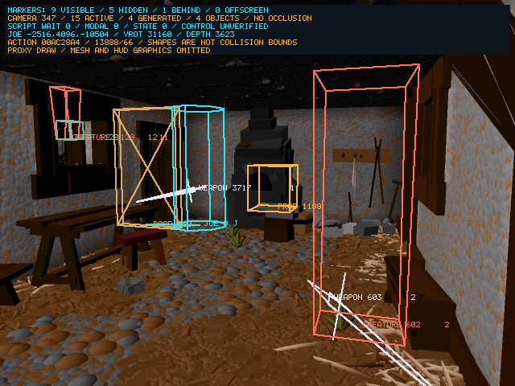
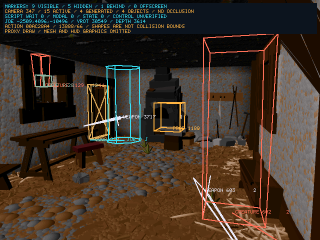

# Longer playthrough, cache reclamation and typed markers — 2026-10-24

<!-- docs-tree:parent -->
[Project README](../../../README.md) · [Parent: Project Journal](../journal.md)
<!-- /docs-tree:parent -->

Task: [Step 09 population and interaction](../../implementations/playable-sdl-runtime/steps/step-09/tasks/task-09-recover-scene-population-and-interaction.md).

The user reports several kills, broken doors and workshop potion attempts, then
an apparent freeze when trying Escape. Review confirms four enemy deaths, two
door destructions and sword attachment. Potion collection is not confirmed.
The exact recording stalls in animation-cache reclamation before Escape reaches
the input pump. Original selected-resource and recursive-disposal contracts are
restored. Diagnostic presentation now uses distinct shapes, colors and labels;
menus suppress that overlay. Debug/ASan input routes complete gameplay, cancel
an Escape menu, reopen it and quit through the actual Yes confirmation.

## Preserved recording and interaction review

Session `session_20261024_131218_211` pins Debug SHA-256
`c2154b412502ed9ef09a5517657ac19cbfc60fb2d8f97fbb1515f12833296627`.
The retained recording and inspection are incomplete after debugger termination,
with no signal stack. A verified immutable export is
`.tmp/replay-bugs/long-play-human-20261024`, also under
`/tmp/e2-long-play-human-20261024`. Export used an inactive `/tmp` copy, preserving
the user's original session and retention protection.

Inspection deltas were materialized with `e2_inspection.Inspection`, rather than
treating delta rows as independent actor snapshots. The following actors all
lose health **100 → 60 → 20 → −20**, enter dying state **5**, then state **11**
with no representation:

| Actor | Original name | Observed outcome |
| --- | --- | --- |
| 602 | `korc2` | Workshop smith dies |
| 293 | `gob3b` | Guard dies |
| 284 | `gob3` | Guard dies |
| 74 | `w_trol` | Troll dies; its `ken:trollpot` callback executes |
| 980 | `kdorr` | Left workshop door collapses and deactivates |
| 963 | `kdora` | Another door collapses and deactivates |

Sword **3717** attaches at snapshot **469** and follows Joe. Joe survives the
route, ending at **(-8665,4096,-11858)** with health **53**, state **4** and
representation **9**. Other enemies are damaged without a recorded death; those
are not counted as kills. Statball/effect deactivations are not counted as kills
or pickups.

The user identifies the workshop as the potion location. Later Space presses
occur at checkpoints **342** and **359**, at **(249,4096,-11612)** and
**(251,4096,-11463)**. The nearby bottle is actor **537**, original name
**`fakepot2`**, at **(428,4096,-11856)**, representation **67**/`potion`. Its
resource's encoded pickup script token **190** is one-based, resolving to script
**189**, **`ken:fakepot`**; it is not script 190/`ken:toilet`. Both attempts leave
the bottle's representation, attachment, state and health unchanged. Joe's yaw
also points away from this bottle during both taps. There is no confirmed potion
collection or health/poison effect here.

A GDB observation of script entries/returns over the compatible recording finds
one `dav:heropick` dispatch (the sword), the door scripts and `ken:trollpot`, but
no green/blue/red/purple potion script dispatch. The repeated `ken:coinvanish`
calls alone do not establish a coin pickup. Actor **4017**/`mpot3` and
**4025**/`mhpot7` appear loaded at distant coordinates; loading/visibility is not
collection. Genuine potion use and point/item collection remain a separate
bounded acceptance target. This review does not turn the user's attempted
interactions into successful pickups.

Evidence: `/tmp/e2-long-play-interaction-transitions.json`, preserved inspection,
`/tmp/e2-long-play-pickup-scripts.json` and
`/tmp/e2-long-play-pickup-trace.log`. The script observer records broader script
traffic as well as the selected potion/coin candidates; entries are filtered by
their actual code ID when assessing outcomes.

## Freeze and original recovery

Exact replay matches through checkpoint **469**, then stops making progress.
Both the initial 90-second run and the longer 220-second run time out. Attaching
a debugger to the agent-owned replay identifies:

`FUN_0045328c ← FUN_0045326c ← FUN_004413fc ← FUN_00444668 ← FUN_004453a4 ← E2R_ParseArchiveFanResource ← FUN_0045190c ← FUN_00451880 ← FUN_00427584`.

The actor is **33**/`w_bxorc3`, loading animation **1439** at archive offset
**11,652,720**. The fixed temporary record pool has **40,000** slots; its cursor
is **40,001** and reclamation keeps reporting success without releasing the
selected resource. The replay remains at sequence **5,103,342,446**, checkpoint
**469**, with Escape latch **0** and modal state **0**. The recording contains no
Escape input. This is a gameplay stall preventing subsequent menu input, not
proof that an Escape handler froze.

Original instructions establish the repairs:

- `0x452fb7..0x452fb9` passes the selected cached **action**, not the current
  simulation tick, to `0x452c70`. Its scene alternative likewise retains the
  selected scene at `0x452fc8..0x452fca`.
- `0x452d2c..0x452d2e` calls `0x43aa14` on that action after unlinking it. The
  prior reconstruction discarded the keyframe pointers and merely marked the
  action, leaving its event records allocated.
- `0x43aa18..0x43aa76` retains the action across keyframe/event disposal, clears
  its table entry and marks its action slot free. That input is now explicit,
  including the action-parser replacement caller at `0x444703..0x44470d`.
- `0x43ab5c..0x43ab5f` saves each heap node's next pointer before freeing the
  current node. The hosted allocator is paired with `LocalFree`; record and
  keyframe free markers retain their original layout. Nested cleanup context is
  restored on return.

The allocator's original scan, fixed capacity and eviction policy are retained;
no enlarged pool, forced success or input bypass is introduced. All reconstructed
repairs have anchored generator mirrors. Independent scratch generation matches
C, header, globals and names.

Compatible replay of the final Debug build passes the stalled load and reaches
the captured prefix end with **all 469 checkpoints matching**, sequence
**5,103,342,446**. It correctly reports **incomplete prefix exhaustion**, not a
complete original run. Fresh input supplies the actual post-gameplay menu/exit
proof. The additional long ASan replay remains incomplete at its **180-second**
bound: it matches through checkpoint **308**, sequence **3,319,732,791**, with
Joe health **100**, state **4** and no sanitizer report. It does not reach the
late reclamation boundary and is not counted as a passing full ASan replay. Stack, locals and original disassembly are retained under
`/tmp/e2-long-play-stall-*` and `/tmp/e2-long-play-original-*`.

## Diagnostic shapes and menu presentation

Host snapshots use original actor/representation names and live flags, health,
state and attachment position. Unknown objects retain the prop category. A
host-only identity cache preserves door/creature classification when their
representation is removed during death/deactivation.

| Category | Presentation |
| --- | --- |
| Joe | Existing cyan cylinder |
| Creature | Red tapered body; category does not assert hostility |
| Corpse | Low muted purple diamond |
| Door | Brown upright slab with crossed braces, following its orientation |
| Broken door | Low brown debris box |
| Potion | Small green bottle outline |
| Weapon | Thin pale blade/hilt following actor orientation, including attachments |
| Other item | Small gold diamond |
| Prop | Compact neutral box; `fakepot` assets are labeled as props |

Labels include category, actor ID and original name. The projected geometry is
illustrative and does not change or claim collision bounds. Corpses and debris
stay low, and loose/held items no longer occupy full character cylinders. The
sidecar includes marker category/name/health/state. Full original meshes and
visible death/collapse animation fidelity remain unaccepted.

The entire diagnostic overlay is suppressed while a requester is active. Before
this change, cylinders and labels obscured Quit, Yes/No and other controls.
This is a host presentation change; recovered menu decisions remain unchanged.
Debug menu and confirmation frames were visually inspected after the change.



## Verification

| Check | Result |
| --- | --- |
| `check-e2-action-reclamation.py E2WIN95.EXE [--asan]` | **4,096** original cache-selection cases and **1,024** action/keyframe/event disposal cases pass in both modes, including heap handoffs, nested context and reuse from a full record pool |
| `check-e2-actor-cylinders.py [--asan]` | All marker shapes, original-name classification, retained corpse/debris identity, projection/clipping, visibility, unchanged mapped state/indexed pixels, erasure and unobscured modal presentation pass |
| Existing pickup fixture under ASan | **4,096** original model-origin and **12,288** original query/caller cases pass |
| Four SDL/X11 Debug/ASan builds | Pass |
| Runtime baseline and input matrix | Pass; all **eight** arrow rows pass |
| Existing SDL requester/OK/update/Escape check | Debug/ASan pass with separate output prefixes |
| Final Debug/ASan SDL gameplay route | Sword pickup, repeated left-door damage/collapse/deactivation, passage, Escape menu, Escape cancellation, reopened Quit, actual Yes confirmation and normal process exit all pass |

The reclamation fixture intercepts name/format diagnostics, scene disposal and
heap frees; it compares their selected arguments and executes actual original
record/keyframe/action disposal and allocator instructions. It does not establish
all scene eviction or heap behavior. Fresh runtime and ASan checks supplement
those bounded contracts.

The existing input-only probe now supports:

```sh
python3 scripts/probe-e2-player-motion.py \
  build/Debug/clang21-i386-sdl/e2recomp \
  --sword-pickup --bash-workshop-door --gameplay-menu-exit \
  --intro-skip-action 1 --intro-skip-progress 83 \
  --background-spawns --burst-frames --timeout 270 \
  --output /tmp/e2-long-play-final-debug
```

Use the ASan executable, 290-second bound and separate output prefix for its
counterpart. Recording is off. It writes no actor coordinates, actions, health,
camera or attachment state. Menu keys and clicks go through SDL; the mouse uses
the computed original item rectangles. The menu test checks requester **0x14**
for Yes/No, rather than the initially mistaken **0x2b** assertion. That initial
probe timeout was a test condition error, not a remaining gameplay freeze.
Both final processes exit normally after Yes. Joe retains health **100**, state
**4** before quitting.

Final SHA-256:

- Debug: `f872624d649031c9dc29791066f635382785b2243fd702ba2068a2e9ae0cd716`.
- ASan: `0f29ecf821afe784b0ec08c26052b90ff76cf5a788803daeb4d82ef0c33547e2`.

Evidence prefixes: `/tmp/e2-long-play-final-{debug,asan,replay}`,
`/tmp/e2-long-play-{reclamation-fixture,markers-fixture}[-asan]`,
`/tmp/e2-long-play-{baseline,controls,parity}` and separate requester logs.
Final logs, JSON, selected frame/state packets and original instructions are
retained in `.tmp/long-play-20261024/final/`.

## Follow-up: door marker placement and creature direction

The user reports an intact door apparently turned around and missing enemy
vectors after the typed markers change. The missing vector was a host drawing
regression: only Joe's cylinder retained the existing projected local +Z line.
Living creature boxes now draw the same line; corpse diamonds do not.

The door issue was an axis and origin mismatch. Before strikes, original actor
**980**/`kdorr` has world position **(−2368, 4096, −10944)**, yaw **16896**,
first-node local offset **(0, −406, −194)**, half-extents **(32, 382, 231)** and
node yaw **256**. Its leaf is broad along local Z, thin along X, and offset from
the actor/hinge. The old centred X-wide slab could not express that placement;
a 180-degree turn of that symmetric box alone would leave it identical.

Original **0x42391b–0x423a64** composes the first-node origin and selects its
basis; **0x423c34–0x423c70** applies yaw, pitch, then roll for the ordinary node
case. The host snapshot now privately computes that transform and draws a box
around the original node's half-extents. It does not invoke a pose update or
write actor data. Missing/invalid model bounds or linked pose targets retain an
illustrative Z-wide slab. Debris retains its low marker. No reconstructed C or
generator change is needed for this host-only correction.

Debug and ASan marker fixtures pass opposite door headings/hinge placement,
visible creature vector endpoints for opposite headings, corpse vector
suppression, existing clipping/presentation cases and unchanged mapped game
memory. SDL/X11 Debug/ASan builds pass. A fresh recording-disabled Debug route
acquires the sword, damages the door **100 → 60 → 20 → −20**, observes state
**11** without a representation and walks **798** world units beyond its plane
with Joe health **100**. The fresh ASan route passes the same damage/collapse
and pickup checks, then travels **816** units beyond the door with health
**100**, state **4** and no sanitizer report. The intact-door frame below was
visually inspected.



Evidence prefixes: `/tmp/e2-door-geometry`,
`/tmp/e2-marker-orientation-{fixture,fixture-asan,debug,asan}`. Original
instructions are `/tmp/e2-door-marker-original-root*.bin`. Logs, state/frame
packets and geometry samples are retained in `.tmp/marker-orientation-20261024/`.
Final rebuilt SDL hashes:

- Debug: `90557987e6b86f22c6a34b67c24b50a8ece77bb672462bafd9d4df852ad07aef`
  (the Debug route preceded a comment-only rebuild).
- ASan: `40e59aacc43f321e09699227792b964725c45d26156b0a0d383f007c5d7c1af1`.

Fixtures use synthetic
actors and do not establish full mesh fidelity. The live route checks this
workshop door; other door assets and collapse animations remain unaccepted.

## Next acceptance

Repeat the longer route and menu exit through normal F5, with the typed markers.
For a real health or poison potion, identify its original actor and script and
verify the actual collection/use effect; the workshop `fakepot2` attempts do not
supply that proof. Other items/points, broad combat, full original rendering,
armed swimming and the earlier ASan courtyard steering/floor-return limits
remain open. No commit or push was made.
