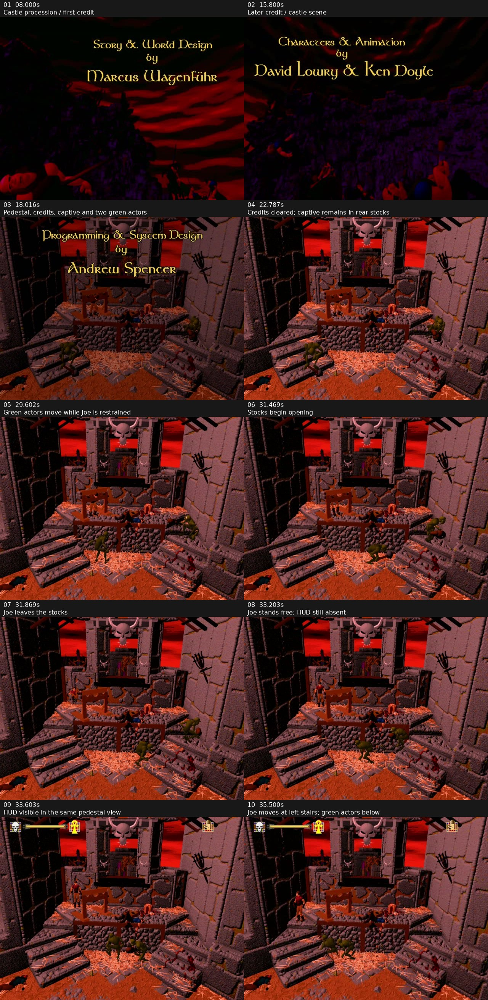

# 2026-10-14 — Original-game video reference

<!-- docs-tree:parent -->
[Project README](../../../README.md) · [Parent: Project Journal](../journal.md)
<!-- /docs-tree:parent -->

Area: castle/credits intro, pedestal restraint and release, first gameplay, and their relationship to the reconstructed runtime at `4fb151a`.

## Source And Method

User-supplied recording: `/home/rgrabowski/Videos/Screencasts/Screencast From 2026-10-14 12-48-42.mp4`.

- SHA-256: `50293953c67ea6a736a448082554cf215cceb5d13720f064205268aa59eeae24`.
- Duration: **39.2597 seconds**; desktop capture **2560×1440**, H.264, variable frame intervals. There is **no audio stream**.
- The user reports an accidental double launch and skipping the first intro. Two game windows are visible in the desktop overview at about 11–14 seconds. The foreground switches, so the early footage is not a single uninterrupted run and cannot establish natural-versus-skipped timing parity. There is no key overlay.
- User clarification: **all three logos cycle quickly because of skip-key taps, and the horseback-riding first intro is also cut short by a skip tap**. Their compressed appearance/absence in sampled frames is not a missing-logo or natural-pacing defect. The taps are known from the user's account even though their exact times/key identity are not visible.
- Timestamps below refer to recording time, not game/script time. Early ranges are approximate. Quarter-second samples were followed by inspection of all **509 decoded frames between 17 and 34 seconds**, with original presentation timestamps, to locate release/HUD transitions.
- The full-screen game image occupies approximately `(320,0)..(2240,1440)`. The retained contact sheet crops those black side margins and scales to 640×480 for comparison; this does not establish the original game's internal render resolution. No game pixels are synthesized.

The contact sheet is retained in the repository. Detailed extraction and frame-timestamp scratch files are under `/tmp/e2-original-video-review-20261014`; the source video remains at the supplied path.

## Screen-By-Screen Observation Log

| Recording time | Visible screen / action | Recompilation relevance |
| --- | --- | --- |
| 00:00–00:02 | Desktop/game launcher; Ecstatica II is selected. | Host setup only; no game-state conclusion. |
| About 00:02–00:04 | Brief/mostly black startup frames and launch notification. The user confirms all three logos are cycled quickly by skip taps. | Sampled images do not resolve each logo or its tap time. This is a skipped-logo route and cannot establish natural logo duration. |
| About 00:04–00:11 | Gold **Story & World Design / Marcus Wagenführ** credit over a dark castle and red sky. A carried/restrained figure and accompanying figures are visible in the foreground/procession. | The first intro contains actors and changing poses in addition to the background and credit text. Correlate with the known `horse` route; the video itself exposes no resource ID. |
| About 00:11–00:15 | Desktop overview exposes two game windows at different states, including black/fading and castle/credit imagery. Foreground selection changes. | Treat this as an observation discontinuity, not a scripted camera change or second in-game intro. The double-launch cause is not established. |
| About 00:15–00:17 | Castle/procession imagery with **Characters & Animation / David Lowry & Ken Doyle** credit, then a dark transition. | Another credit/animation phase; exact key input and elapsed game time remain unknown. |
| About 00:17–00:18 | **Programming & System Design / Andrew Spencer** credit appears as the pedestal courtyard fades in. Red sky, horned skull above a doorway, central raised stone platform, wooden stocks, stairs on both sides and straw are recognizable. Joe is restrained in the rear wooden stocks; two green creatures flank the platform/stairs. | This matches the pedestal backdrop already associated with camera 175 in reconstructed captures. It is a cinematic with live actors, not an acceptable static end state. |
| About 00:18–00:22.45 | Pedestal view remains fixed while the credit persists. The captive and green creatures are visible; creatures change poses. No gameplay HUD. | Credit lifetime, actor animation and camera/background presentation must coexist. |
| About 00:22.49–00:29.3 | Credit disappears. Joe remains restrained in the rear stocks. Two green creatures continue moving/gesturing at the stairs. The horned-skull courtyard stays on screen; no HUD. | Clearing the credit does not mean control has begun. This gives a separate pre-release animation checkpoint. |
| About 00:29.3–00:31.4 | A green creature moves down/across the foreground; the other moves at the right stairs. Joe is still in the stocks. | At least two animated non-player instances are required before the gameplay handoff. Their archive identities and whether motion is scripted or AI-driven are not established by pixels. |
| About 00:31.40–00:33.34 | The top restraint separates/opens; Joe pulls/jumps clear to the left of the stocks, lowers/lands and stands on the upper platform. The green creatures keep moving. No full HUD yet. Contact-sheet frames at **31.469**, **31.869** and **33.203** seconds capture distinct stages. | Acceptance must include a changing restraint and a coherent player animation/position transition, rather than only an elapsed action timer. |
| **00:33.37–00:33.54** | A thin horizontal HUD element begins appearing; by **33.536 seconds** the skull/bar/yellow figure and upper-right icon are present. Joe is free, with the same pedestal backdrop and creatures still visible. | A useful end-of-cinematic/HUD checkpoint. No rooftop cut or action-error requester appears at this boundary. |
| About 00:33.54–00:36.5 | HUD remains visible. Joe moves toward/down the left stairs; green creatures move below/in front of the platform. The user identifies this as actual gameplay. No camera change occurs in the visible interval. | Confirms the initial gameplay view continues in this courtyard. Exact arrow binding, input time, collision and combat outcomes cannot be read from the recording. |
| About 00:36.7–00:39.26 | Desktop overview returns; a game thumbnail briefly retains the pedestal view before focus changes. | End of useful full-screen gameplay evidence, not an observed in-game transition or crash. |

The user explains the story as **restraint → lightning strike/power surge → self-release → gameplay**. The restraint opening, Joe's release and later HUD are directly visible. A distinct lightning bolt/flash was not isolated confidently in the decoded frames, so no exact lightning timestamp or event opcode is assigned. Preserve the user's interpretation as reference context and verify the effect separately against action/event data or clearer footage.

## Distinguishing Joe From Scenery

Joe is the captive **in the rear wooden stocks**, slightly left of the platform centre. His face/body appears through/below the stock board; after release the red-clad figure moves to its left and toward the left stairs. The blue/black foreground body-like form on the front rail remains fixed while Joe moves independently. Do not use that persistent form as proof that a living Joe is rendered, or assume its actor/resource identity from appearance.

The two green creatures are visible independently at left and right and later move in front of the platform. This establishes expected visible instances for this recorded sequence, but does not identify them as resources 319/322/318 or map them to `Start_sc`'s currently traced child records.

## Code Correlation And Confidence

These are investigation connections, not a frame-to-function trace of the original process.

| Reference event | Current source / data connection | Established limit / next observation |
| --- | --- | --- |
| Castle/procession credits | `E2R_RequestIntroSkip`, packed name `horse`, `FUN_0043a6e0`; prior tracing identifies horse resource 1564 and camera family 1073. | The skip helper explicitly loads `Start_sc` and consumes Space there as wait-only. The clip does not prove natural/skip route equivalence or exact credit action ownership. |
| Pedestal cinematic | Packed name `Start_sc`, scene activation through `FUN_004523f8` / `FUN_00452140`; prior tracing identifies script resource **0**, separate from camera **175**. `FUN_0044add8` loads view palettes; known captures load `hires\\0175.raw`. | The courtyard matches the known camera-175 image. This is visual corroboration of the camera target, not a proof that script scene resource 175 owns its actors. |
| Captive pose, stock opening and release | Joe actor 0, render rep 67; action-slot advancement in `FUN_0042ae80`, events in `FUN_0042b880`, pose helpers `FUN_00426124` / `FUN_00426010`, node/render path in Task 02. | Trace action/keyframe/event ownership through each visible phase. The default post-`Start_sc` request for action 384 (`dav:heropick`) is known; the name alone does not establish which release or later animation it implements. |
| Two green creatures before/after release | Scene child activation/loading in `FUN_004523f8`, `FUN_00452140`, `FUN_004533ac`; actor lists and script events. | Expected appearance/motion is now supported by video. Resource identity, instantiation trigger, lifetime and scripted-versus-AI ownership remain Task 03 work. |
| Geometry, overlap and actor motion | Node update, polygon dispatch and flat lighting; dirty-rectangle helpers `FUN_00418484` / `FUN_00418514`. | Actor silhouettes must move correctly relative to the stocks, platform and stairs. Original-code polygon/lighting comparisons do not establish valid vertices, occlusion or rendered actors. Task 11 remains the immediate copy-contract repair. |
| HUD appears after release | `FUN_0044f508`, case **0x75**, clears `DAT_0047a76c` and calls `FUN_004559bc`; that HUD path checks the flag and actor-0 table entry. | A source-backed candidate for the cinematic/control handoff. Trace actual opcode execution, flag transition, HUD pixels and player state together; HUD appearance alone does not establish accepted controls. |
| Initial gameplay stays in courtyard | `FUN_0044c224` selects the camera from actor/query data; `E2R_MarkStartScHandoffIfNeeded` and `E2R_AdjustStartScHandoffScene` temporarily intercept 175→87 once. | Reference supports the initial pedestal view through HUD and the first visible movement. Recover actor/query inputs; do not hold camera 175 permanently or treat the guard as proven original logic. Later camera boundaries are not shown. |

Desktop notifications identify the launched program as **`e2vista.exe`**. The local data directory contains both that executable and the analyzed `E2WIN95.EXE`; they are the same size but differ in **138 bytes**. Their SHA-256 values are respectively `641f06da8440beb8c982d2b57a08edd220d2b5986d283e228568eeca15117df0` and `737e27ddfb76501ba6caf4f504b0c128854a36733526b17d30f635a1c255025b`.

Direct PE-section comparisons find identical bytes in the relevant copy (`0x418484..0x418588`), action/event (`0x42ae80..0x42bba0`), palette (`0x44add8..0x44b3c4`), camera (`0x44c224..0x44c500`), interpreter (`0x44f508..0x45186c`), activation (`0x452140..0x452700`) and HUD (`0x4559bc..0x455e84`) ranges. End addresses are exclusive. This supports those correlations without assuming the executables are identical. The recording alone does not establish the launched file's absolute path or host configuration.

## What The Current Reconstruction Still Lacks

1. **Living player geometry and animation.** The default packet has an empty root update list/zero draw vertices and Joe behind camera 175. Neither the restrained pose nor the opening/jump/landing/walking sequence is recovered as visible game pixels. Gated geometry has a degenerate normal and currently stops in framebuffer copying.
2. **The two moving green creatures.** Current default captures contain Joe alone. The reference demonstrates two visible non-player instances during the cinematic and after HUD entry; activation/resource/animation ownership remains unresolved.
3. **Complete scripted object/effect progression.** The stocks visibly change state as Joe is released. The lightning/power-surge effect described by the user needs a separate source/event correlation; neither a timer reaching 1102/1102 nor a static background proves this sequence.
4. **A successful action-to-gameplay handoff.** The default reconstruction displays `Can't load action` for 384; OK advances updates at camera 87. The recorded reference instead releases Joe, shows the HUD and continues in the courtyard without that error. Recover the action/keyframe path and correct live position/query results; hiding the requester would not recover progression.
5. **Combined visual/control acceptance.** The eight arrow rows prove latches. Required evidence is a rendered player changing pose/position after release, moving relative to the same world and coexisting with the other actors/HUD. Credit fades/timing also need validation independently of the main loop surviving.

The existing background/palette and host presentation are useful recovered pieces: the pedestal environment is recognizable and the reference gives precise places to compare actor silhouettes and overlap. Audio remains stubbed in code, but this silent recording supplies no audio comparison. Menus, save/load, full combat, later cameras, all startup logos and a complete natural intro are not covered.

## Implementation Order And New Acceptance Checkpoints

Keep **Task 11 copy inputs → Task 02 geometry → Tasks 05/01 placement/action validation → Task 03 child activation**, with scene-pose full-route checks as needed. No runtime code or gates change from this analysis.

After the copy repair, take synchronized game/SDL/state packets at five scene-relative events: **restrained Joe/two creatures; credits cleared but still restrained; stocks opening and Joe leaving; free standing Joe before HUD; HUD plus visible player movement in the courtyard**. Record the action slot/id/progress, key/event owner, actor census, coordinates, camera slot, script resource owner, `DAT_0047a76c`, script opcode and geometry counts. Correlate the stock object's update/draw identity too. Preserve those events as separate checkpoints rather than waiting only for scene 175 or a nonblank surface.

Reference absolute timestamps provide event order and comparison frames, not deadlines for probes: duplicate instances, unknown input times, capture timing and runtime pacing prevent a reliable universal duration. Remaining useful reference coverage is a clean single-instance natural-versus-skipped pair, explicit key timings/camera crossing, a clearly captured lightning effect and audio if sound fidelity is to be assessed.

Automated probes must model **logo skip taps, then a separate horseback-intro skip tap, then the wait-only pedestal sequence**. Do not hold a skip key across stages or use a single startup-relative delay as proof of a particular skip. Observe/log the logo/intro state before the relevant tap, release it, and wait on scene/action/HUD checkpoints. Keep a no-skip route separate when validating natural timing; `E2R_STARTUP_LOGO_DELAY_MS=0` is a diagnostic acceleration, not evidence of original timing or key-skip behavior.

Verification for this analysis: media metadata and source SHA-256 recorded; release/HUD events checked against decoded presentation timestamps; the retained contact sheet visually inspected; the listed local executable byte ranges compared; `git diff --check` and all 163 local Markdown link targets in the changed documents pass. Runtime code, builds and regression results are unchanged; no new reconstructed-runtime playability claim is made.
