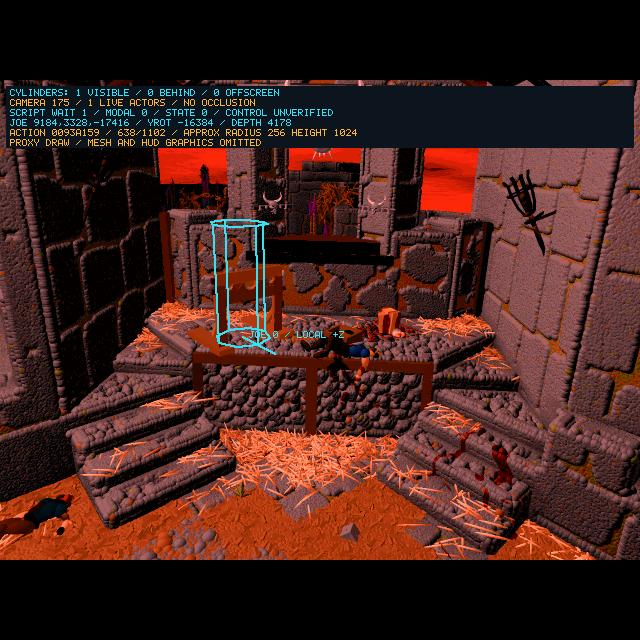
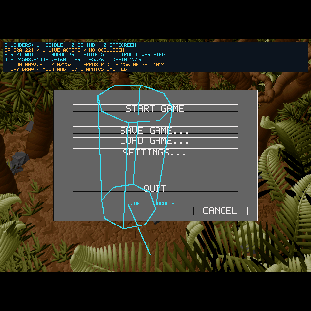

# 2026-10-14 — Palette Regression And Release Handoff

<!-- docs-tree:parent -->
[Project README](../../../README.md) · [Parent: Project Journal](../journal.md)
<!-- /docs-tree:parent -->

Area: palette fade inputs, scene-grid ceiling selection and no-view resource fallback.

**Later continuation:** the [courtyard floor-decoder repair](courtyard-floor-decoder-2026-10-14.md) fixes the shifted descriptors that caused the forest fallback. Its current F5 route defers automatic background spawning explicitly; movement remains unverified. The captures/results below remain historical checkpoints.

Symptom: the user's F5 screenshots show corrupted colors during the pedestal release and a rooftop immediately afterward. The earlier journal described the colors as changing intro lighting; that interpretation was incorrect. The user confirms that the cylinder and freeing sequence now appear in the actual editor launch.

## Recovered Contracts

| Original evidence | Change |
| --- | --- |
| `0x457849..0x457982` computes elapsed × 100 / duration, reverses intensity, retains the clock tick and passes intensity in EAX | Restore `FUN_00457818` fade math/cache/completion flags and explicit intensity arguments in `FUN_00457994/0x457a34`. The previous C lost the scaling and read an uninitialized intensity. |
| `0x422238` retains the saved fade level before resetting it; `0x422297/0x4222ff` submit palette `0x61c730`; `0x43d1a8` passes intensity zero | Repair both frame branches, canonical palette ownership and the menu fade caller. |
| `0x44884b/0x4489a2` clear EAX before loading descriptor byte +5 | Zero-extend the scene-grid ceiling in both lookup routines under `E2R_ACTION_INDEX_PROBE`. Signed extension accepted a ceiling of 255 as -1 and incorrectly selected height -16256. |
| `0x44c453` passes resource 7 in EAX when no view is found | Recover `FUN_0044c224`'s fallback argument. Passing the zero camera selector restarted intro resource 0. Resource 7 is a fallback, not the desired courtyard gameplay. |
| `0x4273cc` receives the actor in EAX; its callback passes selected code and actor through `0x44f310/0x44f320` | Restore the actor, callback ownership and script `0x3a/0x4a` plus death-state caller inputs. Other legacy `0x44f310` callers remain unrecovered. |

The unsigned selection remains coupled to the recovered-action experiment. Promoting it globally exposed the legacy default route's invalid placement/fallback and broke the existing requester checks. Keeping the default signed behavior is a temporary compatibility limitation, like the gated expanded script-name pool. Do not mistake it for the original descriptor type. No world-grid transpose, forced courtyard camera, height clamp or home-coordinate teleport was introduced. All C repairs have narrow generator mirrors.

## Actual Continuous Presentation



At the 12-second packet, camera 175, Joe `9184,3328,-17416`, depth 4178, progress `638/1102`, wait 1/modal 0. The sky is red and the stone/wood colors are coherent again. Indexed hash `321e33d6` agrees with the earlier corrupt-color frame; palette hash is now `cd25bfd5`. This isolates color conversion from changed background content. Prefix `/tmp/e2-palette-fixed-live`.



The corrected lookup excludes the high-ceiling descriptor and avoids the erroneous camera-83 rooftop. The final release position still has no matching floor/view. Resource 7 activates camera 221, plays an animation, deactivates Joe and requests menu `0x27`, state 5. The 35-second packet shows Joe `24508,-14480,-160`, state 11, wait 0/modal 39, selected surface hash `81c8b067`, SDL `6b161ae9`, window `36875ae9`. The run reaches this menu without the prior deactivation fault. Prefix `/tmp/e2-deactivation-live`. This is an erroneous fallback/death route; it does not prove player readiness, movement or traversal.

Both captures come from continuous SDL presentation, without a debugger pause or state edits. They use the three F5 flags, dummy SDL, zero logo delay and queued key-downs. They do not establish physical VS Code key-up handling, natural timing or the user's three logo taps. Keep logo taps, shortened horseback skip and wait-only pedestal phases separate in future probes.

```sh
cmake --build --preset linux-clang32-sdl-debug
env -u DISPLAY SDL_VIDEODRIVER=dummy E2R_STARTUP_LOGO_DELAY_MS=0 \
  E2R_ACTION_INDEX_PROBE=1 E2R_ACTOR_CYLINDERS=1 E2R_PROXY_MESH_BYPASS=1 \
  E2R_VISIBILITY_DUMP_PREFIX=/tmp/e2-release-repro \
  E2R_VISIBILITY_DUMP_AFTER_MS=35000 \
  timeout 48 build/Debug/clang21-i386-sdl/e2recomp \
  --inject-key-sequence-surfaces /tmp/e2-release-repro-surfaces \
  space,space,up 3 10000 42
```

For the pedestal packet, use a fresh prefix, delay 12000 and sequence `space 3 1000 18`. For the actual editor run, select SDL i386 Debug, rebuild and restart **Ecstatica Recompiled**; no new launch flag is required.

## Verification And Limits

The following original-executable fixtures pass normally and under ASan:

- Palette: 2,170 palette-byte/timing/cache/flag/frame-caller cases.
- Scene grid: 16,384 selections, including 32,845 high-ceiling descriptors; four no-view fallback routing cases.
- Actor deactivation: 256 field/table/owner/callback cases.

Run each of `scripts/check-e2-palette-fades.py`, `scripts/check-e2-scene-grid.py` and `scripts/check-e2-actor-deactivation.py` with Python 3, passing `/home/rgrabowski/Games/Ecstatica2/E2WIN95.EXE`, then repeat each with `--asan`. Script-flow ASan checks also pass (176 cursor, 64 wrapper, 32 nested-owner cases and 243 graphic operand spans). Fixtures intercept named dependencies and do not validate full runtime execution.

All four Debug configurations build. Generator syntax, in-place regeneration and scratch comparisons of C/header/globals/names pass. The final default wrapper and SDL requester checks pass, normally and under ASan. The eight-row headless arrow matrix passed after the palette/grid repair, before the subsequent fallback/deactivation repairs; its acceptance is input latching only.

The final experimental ASan run still faults in `FUN_00448744` through `FUN_00448a48 → FUN_00448a3c → FUN_0044dca4 → FUN_0044e354`, reading address `0x27d9e5c2`. It fails shortly after the first skip, before the Debug release boundary. Correct descriptor arithmetic does not repair missing query inputs. Log `/tmp/e2-release-final-asan.log`. Debug's menu result cannot stand in for ASan coverage.

## Next Bounded Investigation

[Step 09 Task 02](../../implementations/playable-sdl-runtime/steps/step-09/tasks/task-02-recover-post-intro-placement-and-motion-queries.md) remains active. Trace the terminal action/callback and scene owner before the first post-release camera query, then recover the actor/vector/mode contracts required to query a valid courtyard placement.

The release's absolute-position event `0x7760a6` decodes `9988,3312,-17408`; this is actual action data, not permission to substitute Joe's home `12800,256,-3584`. The terminal `dav:ending` callback contains `0x39,0x75,0` (graphics cleanup/end-wait), without an explicit teleport. At completion, `FUN_0042b004` resets the key cursor as the original does; its terminal node is `0x7ca495`, key 1102, so it is not an observed replay of every earlier key. Audit the deferred scene-completion callback and action flags before altering ordering. Original `0x42ad87` completes only when progress is greater than duration; reconstructed `0x42ad60` currently uses greater-or-equal and also substitutes the actor slot for the EAX-selected slot. These are source-backed candidates requiring their own bounded proof, not fixes validated here.

After valid placement/control readiness, verify arrow press/release displacement and turning, then a real view-boundary crossing and return. Keep full meshes/HUD/DirectDraw Lock and NPC recovery separate unless one blocks this route.
