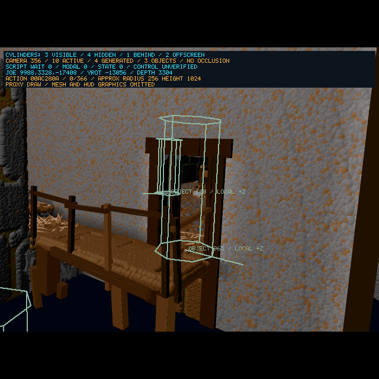

# Workshop Initialization And Actor Visibility — 2026-10-20

<!-- docs-tree:parent -->
[Project README](../../../README.md) · [Parent: Project Journal](../journal.md)
<!-- /docs-tree:parent -->

Task: [Step 09 population and interaction](../../implementations/playable-sdl-runtime/steps/step-09/tasks/task-09-recover-scene-population-and-interaction.md).

## Report And Result

After the sword activation slice, the user reports excessive enemies, doors marked like enemies in camera 356, and a repeat crash approaching the workshop in camera 350:

`0x456924 ← 0x44f508 ← 0x44f320 ← 0x420dcc ← 0x451f5c ← E2R_LoadPopulationActor ← 0x44d634`.

An isolated executable built from the entry-state reconstructed C reproduces the same `FUN_00456924` SIGSEGV at line 52648 when the normal visibility sweep selects camera 350 after 356. Current host diagnostics are retained in that comparison; the workspace source/build is not reverted. Evidence: `/tmp/e2-workshop-prior.log` and `/tmp/e2-workshop-prior-check.log`.

The repaired Debug and ASan builds pass visibility activation **356→350→347**, activate sword actor **3717** at **(-972,3884,-10208)**, restore the prior camera and complete a populated **175→166→175** courtyard return. An ASan GDB audit observes the formerly failing opcode `0x66` setting actor **3737**'s value to **20** in camera 350, three times during initialization. This verifies the actual reported helper path, not only synthetic arguments.

The probe selects original cameras without moving Joe or starting arbitrary script scenes. These results do not establish manual walking into the workshop, pickup or original meshes. The user's walking failure remains the required manual re-entry check after this repair.

## Object Initialization Contract

Original `0x456924..0x456a3c` keeps its actor in EBX from EAX and its amount in EDX. The generated C instead dereferenced an uninitialized `in_EAX`, lost an exhaustion action ID and reused volatile output values for the redraw decision. Recovery retains:

- Actor and amount separately; signed updates to actor `+0x184` with original clamping and wrapped short arithmetic.
- Exhaustion action at `+0x188`, its loaded action-table entry and queue destination `+0x126`.
- The redraw decision across action/HUD callbacks, including attachment-to-Joe handling.

Original opcode `0x66` at `0x450869..0x45089b` supplies the current script actor. Opcode `0x68` at `0x45089c..0x4508e2` supplies the requested actor-table entry. Both generated callers passed a lost temporary instead. Both now retain the actual actor and sign-extend the original signed 12-bit operand. No object initialization is skipped and no arbitrary null/durability substitution is added. Reconstruction changes are mirrored in `GenerateRecon.js`.

## Visibility And Population Audit

The common orange `ACTOR` marker was a presentation category, not an enemy classification. Original archive identities include shelf **536**, crate **608**, cabinet **1201** and door **965** among the user's reported cylinders. Drawing every active actor also included actors whose original view-visibility flag was clear.

The overlay now respects actor flag `+2 & 8`, retaining Joe's diagnostic marker while his mesh is hidden. Enabling that filter exposed another lost argument: original `0x44d2de` passes **actor+0x84** as the visibility-query position, while the C passed the actor record itself. Both query branches in `FUN_0044d2b4` now use the original position and actor. This is a recovered engine argument; the overlay does not repair or mutate visibility itself. The strict pedestal-guard visibility assertions pass after this repair.

Labels now separate cyan `JOE`, amber `SPAWN` for original table-bit-8 generated actors, amber `ACTOR` for other represented/scripted actors and neutral green-grey `OBJECT` for actors without an installed representation or owning script scene. Scripted guards can lack a representation before release, so they retain `ACTOR`. These describe current runtime state, not an exhaustive asset taxonomy or hostility. The panel separates total active, generated, object and hidden counts. F12 includes the same cue fields. Occlusion by walls and real object dimensions remain absent.



This image selects the original view diagnostically; Joe stays in the courtyard. The door and crate retain original positions. The four generated actors are hidden in this view.

Original `FUN_0044e354` still counts active generated actors excluding state `0xb`, caps them at **four**, and uses the original **50-tick** interval. Original instructions `0x44e572..0x44e5a6` and `0x44e35c..0x44e376` match the existing C. All recorded final Debug and ASan censuses count four generated actors, alongside scripted actors and objects. This explains misleading cylinder totals; it does not establish complete enemy-density parity throughout the game. No spawn-rate/cap change or per-enemy whitelist is introduced.

## Verification

Focused fixtures pass normally and under ASan:

- `check-e2-object-durability.py EXE [--asan]`: **1,584** original-x86 field/queue/HUD-callback cases and **16,384** opcode actor/signed-value/cursor cases. Loading and HUD callbacks are intercepted; complete HUD rendering is not tested.
- `check-e2-actor-visibility.py EXE [--asan]`: **18,432** original-x86 visibility flag/query-coordinate cases, including current actor, scene/action visibility overrides and vertical velocity. The world query is intercepted; its actual position/actor arguments are compared.
- `check-e2-population-cap.py EXE [--asan]`: **4,352** original generated-count/state/cap cases and **436** original cadence cases. This tests the unchanged scheduler boundary, not all random selection/placement behavior.
- The expanded ASan cylinder fixture verifies neutral object drawing, generated/scripted categories, hidden-cue filtering, clipping and read-only actor/pixel state. Existing original-code object activation and script-flow fixtures pass under ASan.

Bounded integration command:

```sh
python3 scripts/probe-e2-player-motion.py \
  build/Debug/clang21-i386-sdl/e2recomp \
  --intro-skip-action 1 --pedestal-guards --background-spawns \
  --population-frames 180 --require-background-population \
  --inspect-object-scene 1909 --inspect-approach-cameras 356 350 \
  --camera-round-trip --burst-frames --observe-seconds 5 \
  --timeout 180 --output /tmp/e2-workshop-final-debug
```

Equivalent ASan evidence uses `build/Debug/clang21-i386-sdl-asan/e2recomp` and prefix `/tmp/e2-workshop-final-asan`. That run adds a temporary GDB entry audit recorded in `-durability.json`. Both runs retain visible pedestal guards, original sword placement, an open population gate, camera restoration, both courtyard crossings and five seconds of released-input stability.

All four SDL/X11 Debug/ASan builds, generator syntax, regeneration and independent C/header/globals/names parity pass. Runtime baseline wrapper (`/tmp/e2-workshop-regression-check.log`), all eight control matrix rows (`/tmp/e2-workshop-arrows-check.log`) and default SDL requester presentation/dismissal/resumed-update/Escape checks (`/tmp/e2-workshop-modal-{debug,asan}-check.log`) pass.

Existing staged changes remain byte-for-byte unchanged; this continuation stays unstaged. No commits are made. The next acceptance is ordinary F5 re-entry with a sword F12 packet, followed by recovery of the original pickup/input contract. Attack animations, door destruction, wider combat and full experimental ASan remain open.
